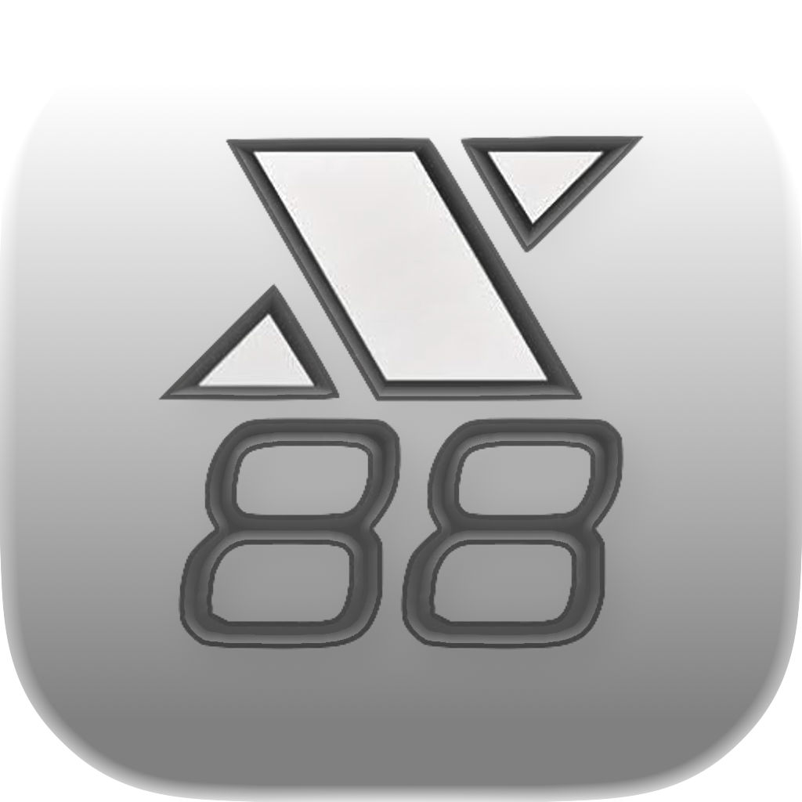
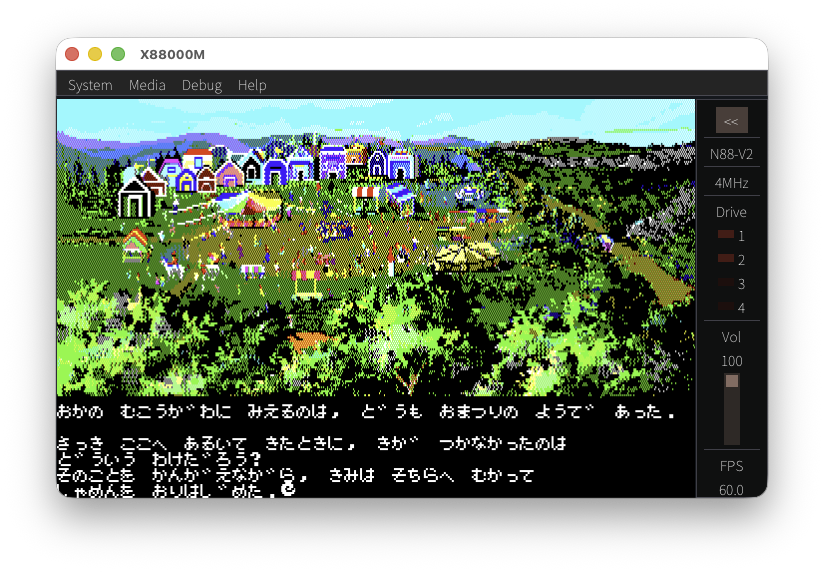
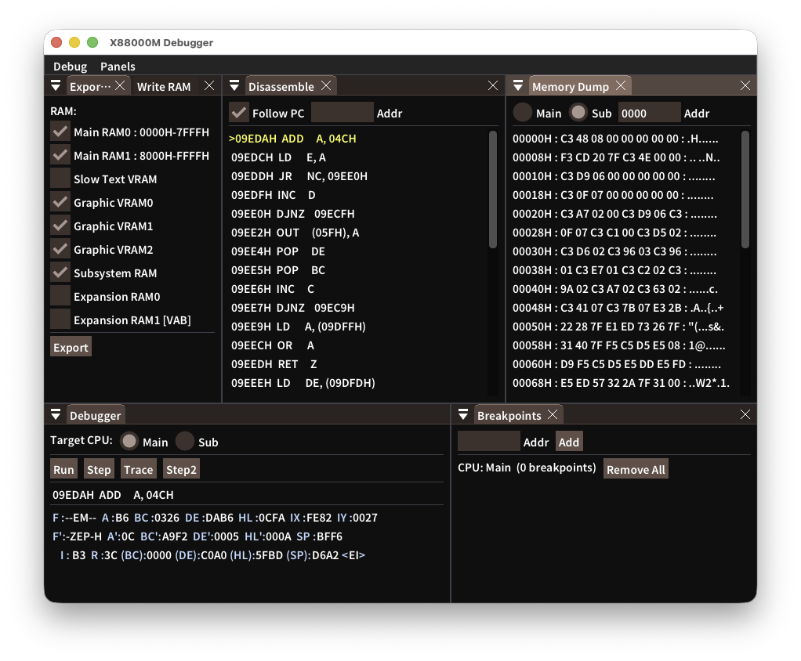

# X88000M

[日本語](./README.md) | English

<p align="center">
  
</p>

X88000M is a macOS / Windows port of `X88000`, the PC-8801 emulator by Manuke.

<p align="center">
  <a href="https://github.com/bubio/X88000M/releases/latest">
    
  </a>
  <a href="https://github.com/bubio/X88000M/blob/main/LICENSE">
    
  </a>
  <a href="https://github.com/bubio/X88000M/actions/workflows/linux.yml">
    
  </a>
  <a href="https://github.com/bubio/X88000M/actions/workflows/macos.yml">
    
  </a>
  <a href="https://github.com/bubio/X88000M/actions/workflows/windows.yml">
    
  </a>
  <a href="https://github.com/bubio/X88000M/releases/latest">
    
  </a>
</p>


Based on the Linux version of X88000, this port replaces GTK 2.0 with SDL3 + Dear ImGui.

## About

<p align="center">
  
</p>

- **One SDL3 + Dear ImGui frontend**
  A consistent interface on macOS and Windows.
- **Quick media access**
  Load `D88`, `T88`, and `CMT` files through menus, drag and drop, or command-line arguments.
- **Multiple images in a D88 file**
  Browse images in `Disk Manager` and assign them to Drives 1–4.
- **Everyday controls**
  Switch BASIC modes and 4/8 MHz clocks, change settings, save screenshots, copy screen text, paste text, preview printer output, and use fullscreen mode.
- **YM2203 / YM2608 support**
  Supports YM2203 (OPN), plus an initial YM2608 (OPNA / Sound Board II) implementation with six FM channels, rhythm samples, and ADPCM.
  Select `YM2203 / OPN`, `YM2608 / OPNA native`, or `YM2203 + Sound Board II` under Sound board in Environment Settings.
  Use `YM2608 / OPNA native` for built-in OPNA configurations such as FH/MH and later models, or `YM2203 + Sound Board II` for YM2203 models such as SR/FR/MR with an added Sound Board II.
- **Debugging tools**
  A separate debugger window, disassembly, memory dumps, breakpoints, RAM export, and execution log recording.

<p align="center">
  
</p>

## Features

- ROM loading and execution
- `D88` insertion and ejection
- `T88` / `CMT` loading and tape controls
- Drag and drop for media files
- Command-line arguments: `--disk1=...`, `--disk2=...`, `--tape=...`
- `Disk Manager` / `Tape Manager`
- `Environment Settings`
- BEEP / PCG / OPNA audio output
- `Debug Window` / `Record Execution Log` / `Export RAM`
- Screenshots, clipboard integration, and printer preview

## System Requirements

### macOS

- macOS 13.5 (Ventura) or later
- Apple Silicon or Intel Mac

### Windows

- Windows 10 or later
- x64 or ARM64

### Linux

- Ubuntu 22.04 LTS or later
- x86_64
- SDL3 dependencies (ALSA, PulseAudio, Wayland, X11, etc.)

## Install

Download the package for your OS from [Releases](https://github.com/bubio/X88000M/releases).

### CI Artifacts

| OS | CI Artifact Name | Release Asset Name |
|---|---|---|
| Linux | `X88000M-{version}-linux-{architecture}.deb` / `X88000M-{version}-linux-{architecture}.rpm` | `X88000M-{version}-linux-{architecture}.deb` / `X88000M-{version}-linux-{architecture}.rpm` |
| macOS (universal) | `X88000M-{version}-macos-universal.zip` | `X88000M-{version}-macos-universal.zip` |
| Windows x64 | `X88000M-{version}-windows-x64.zip` | `X88000M-{version}-windows-x64.zip` |
| Windows arm64 | `X88000M-{version}-windows-arm64.zip` | `X88000M-{version}-windows-arm64.zip` |

`architecture` follows platform conventions: for example, `amd64`/`arm64` for Debian and `x86_64`/`aarch64` for RPM.

### Installing on Linux

Ubuntu/Debian (`.deb`):

```bash
sudo apt install ./X88000M-<version>-linux-amd64.deb
```

Fedora/RHEL (`.rpm`):

```bash
sudo dnf install ./X88000M-<version>-linux-x86_64.rpm
```

> **macOS note:** This app is not notarized by Apple, so Gatekeeper may block the first launch. Use either of these methods:
>
> **Method 1: Remove the quarantine flag in Terminal**
> ```bash
> xattr -cr /Applications/X88000M.app
> ```
>
> **Method 2: Allow the app in System Settings**
> 1. Attempt to open the app and let macOS block it.
> 2. Open System Settings → Privacy & Security.
> 3. Click “Open Anyway” next to the message about X88000M being blocked.

## Before You Start

`X88000M` does not include ROM images. Place your ROM files in the following directory:

| OS | ROM Directory |
|---|---|
| macOS | `~/Library/Application Support/X88000M/` |
| Windows | `%APPDATA%\X88000M\` |
| Linux | `~/.local/share/X88000M/` |

When launched from a terminal, the app also searches the current directory. You can specify a ROM directory with the `X88_ROM_DIR` environment variable.

### Required ROMs

These ROMs are used for standard PC-8801 modes. If you have `pc88.rom`, separate BASIC, extension, and disk ROM files are not needed.

| File | Purpose |
|---|---|
| `pc88.rom`, or `n88.rom` + `n88_0.rom`–`n88_3.rom` + `disk.rom` | N88-BASIC, extension ROMs, and disk boot |
| `kanji1.rom` or `font.rom` | Font for text display |

### Optional ROMs

Add these for the modes or features you use.

| File | Purpose |
|---|---|
| `n80.rom` (32 KiB) | N-BASIC (also needed if `pc88.rom` lacks its N-BASIC section) |
| `n80_2.rom` (32 KiB) | N80-V1 |
| `n80_3.rom` (40 KiB: 32 KiB BASIC + 8 KiB IE ROM) | N80-V2 |
| `e8.rom` (8 KiB) | N80-V1 extension ROM |
| `kanji2.rom` | JIS Level 2 kanji |
| `font80sr.rom` | Dedicated PC-8001mkIISR font |
| `optfont.rom` | Optional font |

## Basic Controls

- Open disks and tapes with `Media -> Open Media...`.
- Drag `D88`, `T88`, or `CMT` files onto the window to load them.
- Change BASIC mode, CPU clock, drive count, and other options in `System -> Environment Settings...`.
- Open the separate debugger with `Debug -> Debug Window...`.

Common shortcuts:

- `Ctrl+O`: Open media
- `Ctrl+R`: Reset
- `Ctrl+P`: Pause / resume
- `Ctrl+1` / `Ctrl+2`: Eject Drive 1 / 2
- `Ctrl+Enter`: Toggle fullscreen

Use `Shift+drop` to target Drive 2. On macOS, use `Cmd+Ctrl+drop` to prioritize Drive 1.

## Building from Source

### Prerequisites

- CMake 3.16 or later (4.2 or later for the Visual Studio 2026 generator on Windows)
- A C++11 compiler
  - macOS: Xcode (Apple Clang)
  - Windows: Visual Studio 2026 (MSVC). Install “Desktop development with C++” and “C++ CMake tools for Windows” using Visual Studio Installer.

SDL3 and Dear ImGui are fetched automatically by default (`X88000M_FETCH_SDL3=ON`, `X88000M_FETCH_IMGUI=ON`).

### macOS

```sh
cmake -S . -B build -DCMAKE_BUILD_TYPE=Release
cmake --build build --target X88000M -j
```

Produces `build/X88000M.app`.

### Windows

From the x64 Native Tools Command Prompt for Visual Studio 2026:

```cmd
cmake -S . -B build -G Ninja -DCMAKE_BUILD_TYPE=Release
cmake --build build --target X88000M --parallel
```

Produces `build\X88000M.exe` and `build\fonts\`.

To use the [Visual Studio 2026 generator](https://cmake.org/cmake/help/latest/generator/Visual%20Studio%2018%202026.html), run the following with CMake 4.2 or later. Use a separate build directory from the Ninja build:

```cmd
cmake -S . -B build-vs2026 -G "Visual Studio 18 2026" -A x64
```

```cmd
cmake --build build-vs2026 --config Release --target X88000M --parallel
```

Produces `build-vs2026\Release\X88000M.exe` and `build-vs2026\Release\fonts\`. For ARM64, replace `-A x64` with `-A ARM64` and install the MSVC build tools for ARM64.

### Linux

Ubuntu 22.04 or later:

```sh
# Install dependencies
sudo apt install build-essential cmake ninja-build pkg-config \
    libasound2-dev libpulse-dev libdbus-1-dev libudev-dev \
    libx11-dev libxcursor-dev libxext-dev libxi-dev \
    libxinerama-dev libxrandr-dev libxkbcommon-dev \
    libwayland-dev libegl1-mesa-dev libgl1-mesa-dev libpipewire-0.3-dev \
    libdecor-0-dev libxtst-dev libibus-1.0-dev libdrm-dev

# Build
cmake -S . -B build -G Ninja -DCMAKE_BUILD_TYPE=Release
cmake --build build --target X88000M --parallel
```

Produces `build/X88000M`.

## Current Notes

- ROM images are not bundled.
- The YM2203/YM2608 implementation uses publicly available official information, such as datasheets, to preserve the PDS license.
- For YM2608 rhythm playback, place `2608_BD.WAV`, `2608_SD.WAV`, `2608_TOP.WAV`, `2608_HH.WAV`, `2608_TOM.WAV`, and `2608_RIM.WAV` in the ROM directory.
- Behavior is not guaranteed to be identical to the original Linux / Windows versions.

## Credits

- Original X88000 by Manuke
- Documentation from the original distribution is included in [src/X88000Src.txt](./src/X88000Src.txt).

## License

The original distribution labels the X88000 source as `PDS` (`Public Domain Software`). Since this does not map directly to a standard SPDX license identifier, this repository preserves the upstream wording in [LICENSE](./LICENSE).

### Third-Party Software

This project uses the following third-party software, which is fetched during the build and statically linked.

| Library | License | Purpose |
|---|---|---|
| [SDL3](https://github.com/libsdl-org/SDL) | zlib License | Window management, input, audio, and rendering |
| [Dear ImGui](https://github.com/ocornut/imgui) | MIT License | GUI (menus, settings, debugger) |
| [Noto Sans JP](https://fonts.google.com/noto/specimen/Noto+Sans+JP) | SIL Open Font License 1.1 | Japanese font |

See the following files for license details:

- SDL3: https://github.com/libsdl-org/SDL/blob/main/LICENSE.txt
- Dear ImGui: https://github.com/ocornut/imgui/blob/master/LICENSE.txt
- Noto Sans JP: [fonts/LICENSE-NotoSansJP.txt](./fonts/LICENSE-NotoSansJP.txt)

The Noto Sans JP license file is bundled in the same directory as the font:

- macOS: `X88000M.app/Contents/Resources/fonts/LICENSE-NotoSansJP.txt`
- Windows: `fonts/LICENSE-NotoSansJP.txt` (in the distribution ZIP)
- Linux: `${CMAKE_INSTALL_DATADIR}/X88000M/fonts/LICENSE-NotoSansJP.txt`
